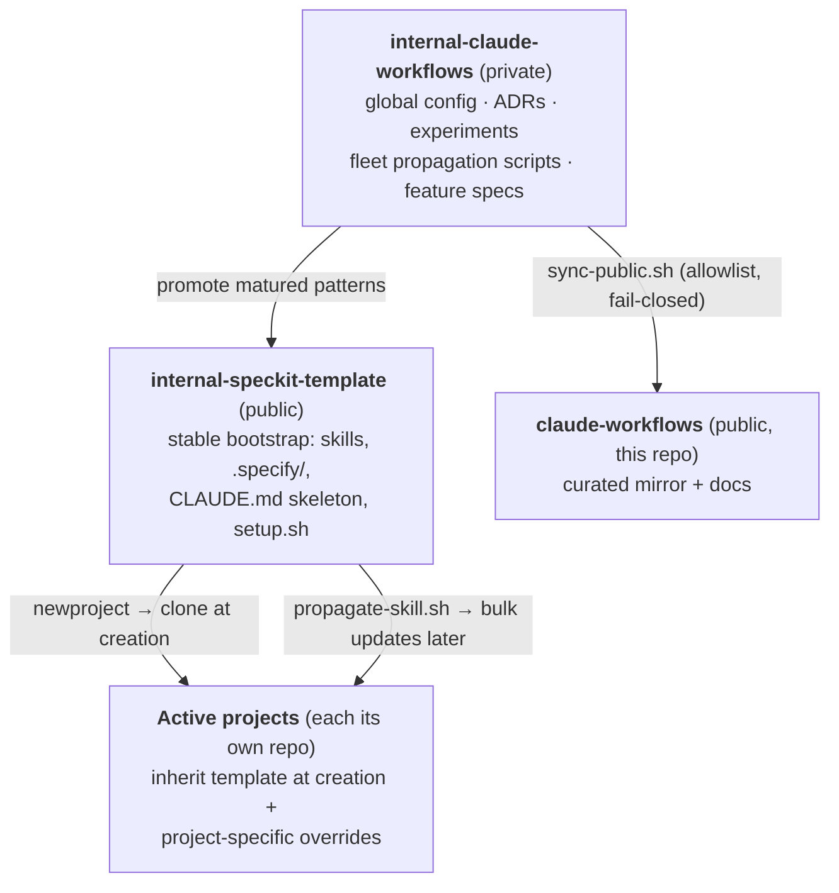

# Architecture: how the pieces fit together

The setup answers one question at three different lifecycles: **where does a change live, and how does it reach everywhere it needs to be?**

## The three layers

Each layer has one job:

| Layer | Owns | Changes |
| --- | --- | --- |
| workflows repo | Personal/global config, decisions, experiments, cross-cutting tooling | Continuously |
| template | The stable bootstrap every new project copies | Only when a pattern has matured |
| projects | Project code + deliberate per-project overrides | Per-project |

**Flow is one-directional.** Experiments happen in the workflows repo. What survives gets promoted into the template. The template reaches projects — at creation via a `newproject` shell function, and after the fact via `propagate-skill.sh`. Skills are never edited in a project and pushed backwards; when a project needs different behavior, that's recorded as intentional drift and the propagation script warns instead of overwriting.

The question to ask before editing anything: **which layer is the source of truth for this file?** The template is canonical for skills shared across projects. The workflows repo is canonical for the global `CLAUDE.md`. A project is canonical only for its own overrides.

## Global config: the symlink model

`scripts/new-machine.sh` bootstraps a fresh machine:

1. Symlinks `dotfiles/claude/CLAUDE.md` → `~/.claude/CLAUDE.md`. There is no copy step and no "which one is canonical" — they are the same file. Edit either path, `git diff` shows the change, push, and every other machine gets it on `git pull`.
2. Copies `dotfiles/claude/settings.example.json` → `~/.claude/settings.json` **as a real file, not a symlink** — settings are per-machine and may carry MCP URLs with org identifiers.
3. Prints manual next-steps for MCP installs, which need per-machine credentials.

The dividing line: **things that are identical everywhere get symlinked to the repo; things that are per-machine get a tracked `.example` and a gitignored real file.** Credentials (`~/.claude.json`, `.env`) are never committed from anywhere.

## Fleet propagation

`propagate-skill.sh <name>` pushes a skill from the template to every project that already has it: reads the canonical copy, diffs against each project's copy, and prompts before each overwrite. `--install-missing` extends it to Claude-Code-aware projects that don't have the skill yet. Two properties matter more than the mechanics:

- **Idempotent.** Re-running on an in-sync project is a no-op, so you can always run it "just in case."
- **Drift-aware.** Projects that customized a skill are on a skip-list and must be updated by hand. Silently clobbering deliberate drift is worse than the toil of a manual edit.

The same shape repeats in `propagate-coderabbit-yaml.sh` (per-repo review config) and `propagate_gates.py` (the gate registry): one canonical source, an explicit list of targets, a diff-and-prompt loop, and skip-lists for the exceptions.

## Decision records

`decisions/` holds ADRs, numbered and append-only. Two rules give the practice teeth:

- **Supersede, never delete.** A reversed decision gets `Status: superseded by NNNN`; the old file stays. The history of *why we stopped* doing something is as valuable as the decision itself.
- **Re-deciding is the trigger.** The moment a question comes up a second time, it becomes an ADR. This is what stops an AI assistant (or future-you) from re-litigating settled questions every session.

## Experiments

`experiments/<name>/` is WIP with an explicit status: `active`, `graduated`, or `killed`. Killed experiments are not removed — each keeps a README postmortem. A fleet of workflow tooling accumulates opinions; the postmortems are the evidence for them.

## The public mirror (this repo)

The private repo also holds things that must stay private: the fleet inventory (which names client repos), rollout specs for client work, and internal change history. Rather than maintain two repos by hand, the public repo is **generated**: `sync-public.sh` rebuilds it from an explicit allowlist (`scripts/public-manifest.txt`) plus a `public/` overlay for these docs, then refuses to commit unless two gates pass:

1. **Denylist grep** — a private list of names/patterns that must never appear. Fail closed: a false positive costs a minute; a false negative publishes a client name forever.
2. **gitleaks** over the staged tree — the same secret scan that runs in CI.

Because the mirror is rebuilt from scratch on every sync, removing a path from the manifest removes it from the mirror. Nothing can leak by drift — a file is either allowlisted or it doesn't exist here. The public repo's history is also fresh: it never inherited the private repo's history, so there is nothing to scrub retroactively.
